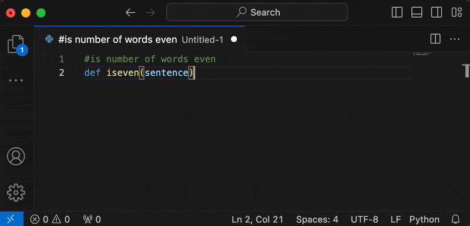

# Ollama Autocoder

A simple, fast Ollama autocompletion engine built for newer local models: real
system prompting, a replacement-keyword marker, a lookahead stop boundary, and
token streaming.

## Requirements

- Ollama must be serving on the API endpoint configured in settings. It defaults to
  the **chat API** (`http://localhost:11434/api/chat`). For installing Ollama, visit
  [ollama.ai](https://ollama.ai).
- Ollama must have the `model` from settings installed. The current default is
  `ornith-1.5:9b`. Any modern instruction- or code-tuned model works; because
  completions now go through the chat API with a system prompt, a model that follows a
  chat structure produces the best results.
- The `prompt window size` should be in line with the model's maximum context window.
  It counts **characters, not tokens**, so setting it larger than the model's token
  limit is fine and often recommended.

## How to Use

1. In a text document, press space *(or any character in the `completion keys`
   setting)*. The `Autocomplete with Ollama` option — or a preview of its first line —
   will appear. Press `enter` to start generation.
   - Alternatively, run the `Autocomplete with Ollama` command from the command
     palette (or on a keybind you set).
2. Tokens stream into the cursor and are left *selected*, so a single `undo` reverts
   the whole completion. Pressing a completion key gives a single-line hint that stops
   at the end of the line, like a legacy autocomplete; the `Autocomplete with Ollama`
   command instead runs a full multi-line generation that stops where the following code
   resumes (`lookahead`).
3. To stop early, click "Cancel" on the `Ollama Autocoder` notification or start typing.
4. When generation stops, the notification disappears.

## Settings

All settings live under `Ollama Autocoder` in `settings.json` or the Settings UI.

| Setting | Default | Description |
| --- | --- | --- |
| `endpoint` | `http://localhost:11434/api/chat` | Ollama REST endpoint. Defaults to the chat API; point it at `/api/generate` only if your proxy exposes that instead. |
| `bearer token` | _(unset)_ | Bearer token for reverse proxies that require auth. Not usually needed. Use **Set Ollama API Bearer Token**. |
| `model` | `ornith-1.5:9b` | Model used to generate completions. |
| `think` | `false` | Disables the reasoning phase. Thinking models otherwise put their reply in `message.thinking`, leaving `message.content` (the completion) empty. |
| `system prompt` | _(completion prompt)_ | The system prompt sent to the model. The placeholders `{LANG}`, `{FILE_NAME}`, `{PROJECT_NAME}`, and `{REPLACEMENT_KEYWORD}` are substituted. Keep the same shape if you edit it; leave blank for no system prompt. |
| `max tokens predicted` | `10000` | Maximum number of tokens generated per completion. |
| `prompt window size` | `200000` | How much code before the cursor to include in the prompt, in characters. |
| `replacement keyword` | `<\|COMPLETE\|>` | A marker placed at the cursor that the model completes _from_ and that also acts as a stop sequence, so it is never repeated in the output. Pick something that does not appear in your code. |
| `lookahead` | `20000` | How far past the cursor to look for a stop boundary on the *multi-line* Autocomplete command: the completion stops at the following code's first non-empty line instead of overwriting it. The on-completion-key suggestion always stops at the end of its line. `0` completes the command to the end of the document. |
| `completion keys` | `[" ", "\n"]` | Characters that invoke the completion provider. `\n` is parsed as a newline. **Requires reload.** |
| `response preview` | `true` | Use the first line of the response as the inline preview label. Not streamable; disable on slow devices. |
| `preview max tokens` | `50` | Maximum number of tokens generated for the inline preview. |
| `preview delay` | `0.2` | Seconds to wait before starting the inline preview, to avoid firing the model on every keystroke. |
| `temperature` | `0.2` | Sampling temperature. Lower is generally better than you would use for dialogue. |

## Commands

| Command | Default keybind | Description |
| --- | --- | --- |
| `Autocomplete with Ollama` | _(none)_ | Run a full multi-line generation streamed into the cursor with a selection to undo. It "sees ahead" (`lookahead`) and stops at the following code instead of the first newline. |
| `Set Ollama API Bearer Token` | _(none)_ | Store or clear the bearer token. |

## Notes

- For fastest results, an Nvidia GPU or Apple Silicon is recommended. CPU still works on
  small models.
- A completion is grounded only in the code **behind** the cursor (plus the replacement
  marker). The `lookahead` window is used solely to pick where the completion should stop
  — it is **not** sent to the model — so following code is never part of its input.
- For CPU-only, low-end, or battery-powered devices, disabling `response preview` is
  recommended, as it otherwise fires the model on the completion key. You can also increase
  `preview delay`.
- The default `endpoint` is now the chat API. If a reverse proxy only exposes
  `/api/generate`, set `endpoint` accordingly; responses are parsed from both the chat
  (`message.content`) and legacy (`response`) shapes.
